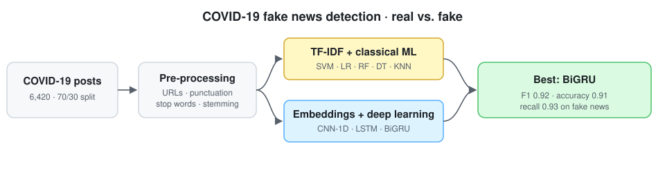

<div align="center">

# COVID-19 Fake News Detection with Machine and Deep Learning
### Towards a fake-news-resistant society

[%20e0315407-1f6feb)](https://doi.org/10.1371/journal.pone.0315407)
[](https://doi.org/10.1371/journal.pone.0315407)
[](#installation)
[](LICENSE)
[](https://github.com/marif561/NLP-Sentiment-Analysis/actions/workflows/tests.yml)

Code and results for **"Machine and deep learning algorithms for sentiment analysis during COVID-19: A vision to create fake news resistant society"**, *PLoS ONE* 19(12): e0315407, 2024 (open access).

Muhammad Tayyab Zamir¹ · Fida Ullah¹ · Rasikh Tariq² · Waqas Haider Bangyal³ · **Muhammad Arif**¹ · Alexander Gelbukh¹

¹ CIC, Instituto Politécnico Nacional, Mexico · ² Institute for the Future of Education, Tecnológico de Monterrey, Mexico · ³ Kohsar University Murree, Pakistan

</div>

---

## About the paper

During the COVID-19 pandemic, false claims about the virus, how it spreads and how to treat it reached people faster than corrections did. This caused confusion and real risk to public health. This study builds an automatic detector that labels COVID-19 news posts as **real** or **fake**. It compares classical machine-learning classifiers on TF-IDF features with deep-learning models that learn their own word embeddings. A **bidirectional GRU** gives the best result, with an **F1-score of 0.92** and 0.91 accuracy. The paper frames the work as a step towards digital and media literacy, helping educators and the public become more resistant to misinformation.

<p align="center">
  
</p>

## Highlights

- 📰 **6,420** labelled English COVID-19 posts: **3,360 real**, **3,060 fake**
- 🧹 Preprocessing: URLs, punctuation and stop words removed, stemming, TF-IDF
- 🧪 Classical ML (SVM, Logistic Regression, Random Forest, Decision Tree, KNN) vs. deep learning (CNN-1D, LSTM, BiGRU)
- 🏆 **BiGRU: accuracy 0.91 · precision 0.90 · recall 0.93 · F1 0.92**
- 🎓 Framed around media literacy and informal education via social media

## Dataset

**COVID Fake News Dataset** on Kaggle (uploaded by *csmalarkodi*, retrieved August 2023): 6,420 posts with an ID, the text and a `real` / `fake` label. The paper uses a **70 / 30** train/test split. The data is not redistributed here. See [`data/README.md`](data/README.md).

## Results

Test-set scores reported in the paper (Tables 3a and 4a).

| Family | Model | Accuracy | Precision | Recall | F1 |
|---|---|:-:|:-:|:-:|:-:|
| Deep learning | **BiGRU** | **0.91** | 0.90 | **0.93** | **0.92** |
| | LSTM | 0.90 | 0.93 | 0.88 | 0.90 |
| | CNN-1D | 0.71 | 1.00 | 0.43 | 0.60 |
| Machine learning | SVM (RBF) | 0.89 | 0.88 | 0.91 | 0.90 |
| | Random Forest | 0.89 | 0.87 | 0.92 | 0.90 |
| | Logistic Regression | 0.89 | 0.87 | 0.92 | 0.89 |
| | Decision Tree | 0.85 | 0.84 | 0.87 | 0.85 |
| | KNN (k = 5) | 0.73 | 0.96 | 0.50 | 0.66 |

**Takeaways**

- BiGRU and LSTM do best. Strong TF-IDF baselines (SVM, Random Forest, Logistic Regression) come within 1–2 points.
- CNN-1D and KNN have very high precision but low recall. They flag fake news only when they are very sure and miss about half of it.

> **Note on reported numbers.** A few figures in the published article don't line up exactly. The BiGRU confusion-matrix counts in the text (TN 555, TP 580, FN 81, FP 68) work out to about 0.88 accuracy rather than 0.91. Some macro/weighted-average tables have one fewer column of values than model headers. The table above uses the headline values. [`results/`](results/) keeps the per-model tables as published.

## Repository structure

```
.
├── configs/                 # Hyperparameters from the paper
├── data/                    # Expected format + tiny invented sample
├── docs/figures/            # Pipeline diagram
├── results/                 # Paper results as CSV
├── scripts/run_all.sh       # Run every model
├── tests/                   # Unit tests (CI on every push)
└── src/covidfake/
    ├── data.py              # Loading, label mapping, 70/30 split
    ├── preprocess.py        # Cleaning, stop words, stemming
    ├── metrics.py           # Accuracy, precision, recall, F1 (fake = positive)
    ├── train_ml.py          # TF-IDF + SVM / LR / RF / DT / KNN / NB
    └── train_dl.py          # CNN-1D / LSTM / BiGRU (PyTorch)
```

## Installation

```bash
git clone https://github.com/marif561/NLP-Sentiment-Analysis.git
cd NLP-Sentiment-Analysis
python -m venv .venv && source .venv/bin/activate
pip install -r requirements.txt
pip install -e .
```

## Usage

```bash
# Classical ML baselines on TF-IDF features
python -m covidfake.train_ml --data data/covid_fake_news.csv

# Deep-learning models
python -m covidfake.train_dl --data data/covid_fake_news.csv --model bigru
python -m covidfake.train_dl --data data/covid_fake_news.csv --model lstm
python -m covidfake.train_dl --data data/covid_fake_news.csv --model cnn

# Everything
bash scripts/run_all.sh data/covid_fake_news.csv
```

Each run uses a stratified 70/30 split (seed 42) and writes metrics, the confusion matrix and test predictions to `outputs/`.

> **Code.** The authors' original code is at [tayyabawan786/covid19-project](https://github.com/tayyabawan786/covid19-project), as stated in the paper's data-availability section. `src/` here is a clean, tested reference implementation of the same pipeline and hyperparameters. The deep models are re-implemented in PyTorch, so exact scores can differ slightly.

## Citation

```bibtex
@article{zamir2024covid,
  title   = {Machine and deep learning algorithms for sentiment analysis during {COVID-19}:
             A vision to create fake news resistant society},
  author  = {Zamir, Muhammad Tayyab and Ullah, Fida and Tariq, Rasikh and Bangyal, Waqas Haider and
             Arif, Muhammad and Gelbukh, Alexander},
  journal = {PLoS ONE},
  volume  = {19},
  number  = {12},
  pages   = {e0315407},
  year    = {2024},
  doi     = {10.1371/journal.pone.0315407}
}
```

## Acknowledgements

Supported by Tecnológico de Monterrey through the Challenge-Based Research Funding Program 2023 (project *Complex Thinking Education for All*, CTE4A, ID IJXT070-23EG99001) and the Writing Lab of the Institute for the Future of Education.

## License

Code is released under the [MIT License](LICENSE). The article is open access under CC BY 4.0. The dataset is subject to its Kaggle licence.
